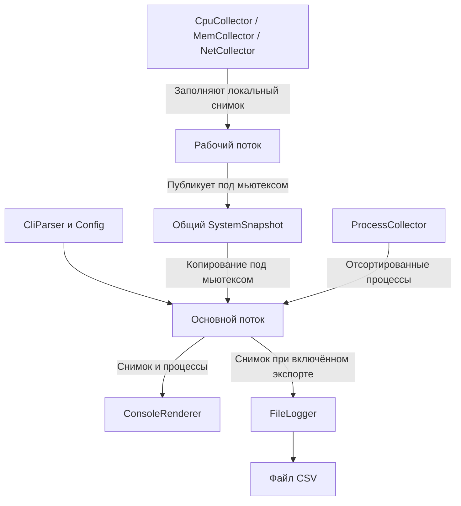

# Linux System Monitor

Многопоточный консольный монитор системных ресурсов и процессов Linux на C++17. Получает данные напрямую из `/proc`, отображает их в терминале и поддерживает экспорт системных метрик в CSV.

## Возможности

- Мониторинг загрузки CPU, использования RAM и скорости сетевого трафика (RX/TX).
- Таблица процессов с PID, CPU%, состоянием, RSS и именем процесса.
- Сортировка процессов по CPU, памяти или PID.
- Настраиваемый интервал обновления, размер таблицы и цветовое оформление.
- Экспорт системных метрик в CSV.
- Обновление интерфейса через ANSI escape-последовательности и завершение работы по `Ctrl+C`.

## Пример вывода

```text
CPU: [░░░░░░░░░░░░░░░░░░░░] 2.7%
RAM: [█████░░░░░░░░░░░░░░░] 2280/7939 MB (28.7%)
NET: RX : 21.3 KB/s  TX : 20.8 KB/s
PID     CPU%    STATE   RSS(MB)     NAME
431690  0.7     S       730.6       MainThread
438758  0.5     R       3.7         monitor
431617  0.5     S       23.7        code-8a14f0cc1b
```

## Сборка и запуск

Требования: Linux с доступным `/proc`, GCC или Clang с поддержкой C++17, CMake 3.24 или новее. При первом конфигурировании GoogleTest загружается через `FetchContent`, поэтому требуется доступ к сети.

```bash
git clone https://github.com/Moksimqa/linux-system-monitor.git
cd linux-system-monitor
cmake -S . -B build
cmake --build build
./build/monitor
```

Права root для обычного запуска не требуются. Доступность данных отдельных процессов зависит от прав пользователя и настроек `/proc`.

## Аргументы командной строки

| Аргумент | Назначение | По умолчанию |
| --- | --- | --- |
| `--help` | Вывести справку и завершить работу | — |
| `--sort cpu\|mem\|pid` | Сортировка по CPU/RSS (убывание) или PID (возрастание) | `cpu` |
| `--interval <ms>` | Пауза между итерациями, мс | `1000` |
| `--limit <N>` | Максимальное количество процессов в таблице | `15` |
| `--no-color` | Отключить цветовое оформление | Цвет включён |
| `--output <path>` | Записывать системные метрики в CSV | Запись отключена |

```bash
./build/monitor --help
./build/monitor --sort mem --limit 10 --interval 500
./build/monitor --sort pid --no-color
```

`--interval` и `--limit` принимают положительные целые числа. Фактический период обновления включает время сбора и вывода данных. Лимит строк следует выбирать с учётом высоты терминала.

## Экспорт в CSV

```bash
./build/monitor --output metrics.csv --interval 500
```

```csv
timestamp_ms,cpu_percent,mem_percent,rx_kbs,tx_kbs
1795550273697,2.25,28.8657,23.7711,23.6657
1795550274214,2.99252,28.7484,22.7429,22.8776
```

`timestamp_ms` — время записи в миллисекундах от начала эпохи Unix. Экспорт содержит общие системные метрики, без статистики отдельных процессов.

При запуске с `--output` существующий файл перезаписывается. Без этого аргумента запись отключена. Некорректные аргументы или ошибка открытия файла приводят к завершению с кодом `1`. Ошибки записи и сброса буфера пока отдельно не обрабатываются.

## Архитектура

Схема показывает поток данных между компонентами приложения.



- Рабочий поток владеет коллекторами через `std::unique_ptr<IMetricCollector>`. Коллекторы заполняют локальный `SystemSnapshot`, который затем публикуется в общий объект под мьютексом.
- Основной поток копирует `SystemSnapshot` под тем же мьютексом и освобождает блокировку. Он вызывает `ProcessCollector`, передаёт снимок и отсортированные процессы в `ConsoleRenderer`, а при включённом экспорте — снимок в `FileLogger`. Сбор процессов, сортировка, отрисовка и запись CSV выполняются вне критической секции.
- `ProcessCollector` хранит предыдущие CPU-счётчики по PID и проверяет `starttime`, чтобы не сравнивать измерения разных процессов при повторном использовании PID. Сортировка реализована через `std::sort`.
- `CliParser` формирует `Config`, проверяя числовые аргументы через `std::from_chars`. Необязательный `FileLogger` владеет `std::ofstream` и закрывает файл через RAII.

До первой публикации снимка рабочим потоком начальный кадр и первая строка CSV могут содержать нулевые значения.

### Источники метрик

| Источник | Данные |
| --- | --- |
| `/proc/stat` | Общая загрузка CPU по дельтам счётчиков; время простоя включает `idle` и `iowait` |
| `/proc/meminfo` | Используемая RAM: `MemTotal - MemAvailable` |
| `/proc/net/dev` | RX/TX по дельтам счётчиков интерфейсов и времени `steady_clock`, без `lo` |
| `/proc/[PID]/stat` | Имя, состояние и CPU-счётчики процесса, время запуска `starttime` |
| `/proc/[PID]/status` | Резидентная память процесса (`VmRSS`) |

CPU% процесса рассчитывается относительно суммарного процессорного времени всех логических CPU. Например, полная загрузка одного из восьми логических CPU соответствует примерно 12,5%. До появления сопоставимых замеров CPU% процесса равен нулю.

Скорости сети и объёмы памяти измеряются в KiB/s и MiB соответственно (в интерфейсе подписаны как `KB/s` и `MB`).

## Тестирование

GoogleTest используется для проверки парсеров CPU, RAM, сетевых данных, процессов и аргументов командной строки. При сборке включены предупреждения `-Wall -Wextra -Wpedantic`.

```bash
ctest --test-dir build --output-on-failure
```

Отдельная сборка с AddressSanitizer и UndefinedBehaviorSanitizer:

```bash
cmake -S . -B build-sanitize -DENABLE_SANITIZERS=ON -DCMAKE_BUILD_TYPE=Debug
cmake --build build-sanitize
ctest --test-dir build-sanitize --output-on-failure
./build-sanitize/monitor --output build-sanitize/metrics.csv --interval 500
```

## Структура проекта

```text
include/        Интерфейсы, заголовки и модели данных
src/            Коллекторы, парсеры, вывод, CLI и экспорт
tests/          Unit-тесты GoogleTest
CMakeLists.txt  Конфигурация сборки и тестирования
```

## Планы развития

- История метрик на основе кольцевого буфера и компактные графики.
- Интерактивный терминальный интерфейс с управлением с клавиатуры.
- Расширение тестов и проверка многопоточной части.
