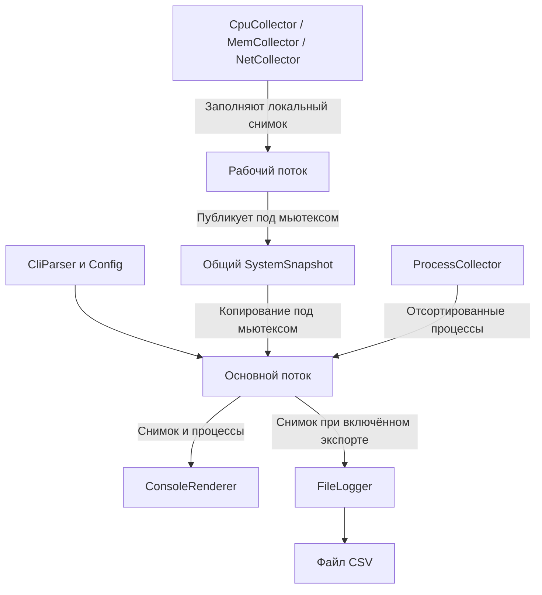

# Linux System Monitor

Многопоточный консольный монитор системных ресурсов и процессов Linux на C++17. Собирает метрики напрямую из `/proc`, отображает их в терминале и позволяет сохранять статистику в CSV.

Проект разрабатывается как курсовая работа и практика системного программирования на Linux.

## Возможности

- Загрузка CPU, использование RAM, скорость приёма и передачи сетевых данных.
- Таблица процессов с PID, загрузкой CPU, состоянием, RSS и именем процесса.
- Сортировка по CPU%, RSS или PID с ограничением числа строк.
- Настраиваемый интервал обновления и отключение цветового оформления.
- Экспорт системных метрик в CSV.
- Обновление консольного интерфейса через ANSI escape-последовательности.
- Завершение работы по `Ctrl+C` с ожиданием рабочего потока.

## Сборка и запуск

Для сборки нужны Linux с доступным `/proc`, GCC или Clang с поддержкой C++17 и **CMake 3.24 или новее**. При первом конфигурировании CMake скачивает GoogleTest через `FetchContent`, поэтому нужен доступ к сети.

```bash
git clone https://github.com/Moksimqa/linux-system-monitor.git
cd linux-system-monitor
cmake -S . -B build
cmake --build build
./build/monitor
```

Для обычного запуска права root не требуются. Доступность сведений об отдельных процессах зависит от прав пользователя и настроек `/proc`.

### Аргументы командной строки

| Аргумент | Назначение | По умолчанию |
| --- | --- | --- |
| `--help` | Вывести справку и завершить работу | — |
| `--sort cpu\|mem\|pid` | Сортировка по CPU%, RSS или PID | `cpu` |
| `--interval <ms>` | Пауза между обновлениями в миллисекундах | `1000` |
| `--limit <N>` | Максимальное количество процессов в таблице | `15` |
| `--no-color` | Отключить цветовое оформление | Цвет включён |
| `--output <path>` | Записывать системные метрики в CSV | Запись отключена |

При `--sort cpu` и `--sort mem` на первом месте процесс с наибольшим значением. При `--sort pid` первым идёт наименьший PID.

```bash
./build/monitor --help
./build/monitor --sort mem --limit 10 --interval 500
./build/monitor --sort pid --no-color
```

`--interval` и `--limit` принимают положительные целые числа. Некорректные аргументы или ошибка открытия CSV приводят к завершению программы с кодом `1`.

### Пример вывода

```text
CPU: [██░░░░░░░░░░░░░░░░░░] 12.5%
RAM: [█████░░░░░░░░░░░░░░░] 2280/7939 MB (28.7%)
NET: RX : 21.3 KB/s  TX : 20.8 KB/s
PID     CPU%    STATE   RSS(MB)     NAME
431690  0.7     S       730.6       MainThread
438758  0.5     R       3.7         monitor
431617  0.5     S       23.7        code
```

## Архитектура



Рабочий поток владеет коллекторами через `std::unique_ptr<IMetricCollector>`. Коллекторы читают `/proc` и заполняют локальный `SystemSnapshot`. Готовый снимок рабочий поток копирует в общий объект под `std::lock_guard`.

Основной поток копирует снимок под тем же мьютексом и сразу освобождает блокировку. Затем `ProcessCollector` читает сведения о процессах и сортирует их через `std::sort`. При сравнении двух замеров он проверяет и PID, и `starttime`, поскольку между замерами Linux может выдать тот же PID другому процессу. Запись в CSV и отрисовка выполняются вне блокировки.

Параметры запуска хранятся в `Config`. Числовые аргументы `CliParser` разбирает через `std::from_chars`. При запуске с `--output` объект `FileLogger` открывает `std::ofstream` один раз. Поток закрывается при уничтожении объекта.

### Источники и расчёт метрик

| Источник | Данные и расчёт |
| --- | --- |
| `/proc/stat` | Общая загрузка CPU по разности двух замеров. Время простоя включает `idle` и `iowait` |
| `/proc/meminfo` | Используемая память равна `MemTotal - MemAvailable` |
| `/proc/net/dev` | RX/TX по дельтам счётчиков отдельных интерфейсов и прошедшему времени (`steady_clock`). Интерфейс `lo` пропускается |
| `/proc/[PID]/stat` | Имя, состояние, `utime`, `stime`, `starttime` процесса |
| `/proc/[PID]/status` | Резидентная память процесса (`VmRSS`) |

CPU% процесса — его доля в суммарном процессорном времени всех логических CPU за интервал. Например, на машине с восемью логическими CPU полная загрузка одного из них одним процессом соответствует примерно 12,5%. При первом замере процесса монитор показывает 0%, пока не появится второй замер для сравнения.

Значения скорости сети приведены в KiB/s, объёма памяти — в MiB. В интерфейсе эти единицы подписаны как `KB/s` и `MB`.

## Экспорт в CSV

`--output` создаёт файл или перезаписывает существующий при запуске. Например, следующая команда записывает системные метрики в `metrics.csv` до остановки по `Ctrl+C`.

```bash
./build/monitor --output metrics.csv --interval 500
```

Пример записанных строк вместе с заголовком.

```csv
timestamp_ms,cpu_percent,mem_percent,rx_kbs,tx_kbs
1795550273697,2.25,28.8657,23.7711,23.6657
1795550274214,2.99252,28.7484,22.7429,22.8776
1795550274724,2.24439,28.7532,24.9508,24.1507
```

`timestamp_ms` — время записи строки в миллисекундах с начала эпохи Unix. В CSV попадают общая загрузка CPU, процент занятой RAM и скорости RX/TX. Статистика отдельных процессов выводится в терминал.

## Тестирование

Unit-тесты на GoogleTest проверяют парсеры CPU, RAM, NET, процессов и CLI. Для сборки приложения и тестов включены предупреждения `-Wall -Wextra -Wpedantic`.

```bash
ctest --test-dir build --output-on-failure
```

Для проверки с AddressSanitizer и UndefinedBehaviorSanitizer используется отдельный каталог сборки.

```bash
cmake -S . -B build-sanitize -DENABLE_SANITIZERS=ON -DCMAKE_BUILD_TYPE=Debug
cmake --build build-sanitize
ctest --test-dir build-sanitize --output-on-failure
./build-sanitize/monitor --output build-sanitize/metrics.csv --interval 500
```

По результатам проверки, зафиксированной 24 ноября 2026 года, CTest прошёл в обеих сборках — по 25 из 25 тестов. CSV-экспорт и работу интерфейса проверяли вручную.

## Структура проекта

```text
include/        Заголовочные файлы, модели данных и интерфейсы
src/            Коллекторы, парсеры, renderer, CLI, CSV и main
tests/          Unit-тесты GoogleTest
CMakeLists.txt  Конфигурация сборки и тестирования
```

## Известные ограничения

- Первый кадр и первая строка CSV могут содержать нулевые значения до публикации первого снимка рабочим потоком.
- `--interval` задаёт паузу между итерациями. Сбор и вывод занимают дополнительное время, поэтому фактический интервал между строками CSV может быть больше.
- Размер таблицы пока не адаптируется к высоте терминала.
- Ошибки открытия CSV обработаны, ошибки записи и сброса буфера — пока нет.

## Планы

- Хранить историю метрик в кольцевом буфере и отображать её компактными графиками.
- Добавить управление терминальным интерфейсом с клавиатуры.
- Расширить тесты коллекторов и проверить многопоточную часть проекта.
